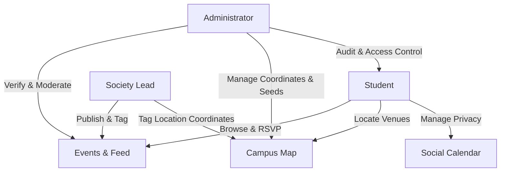
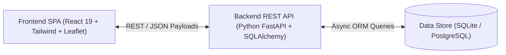
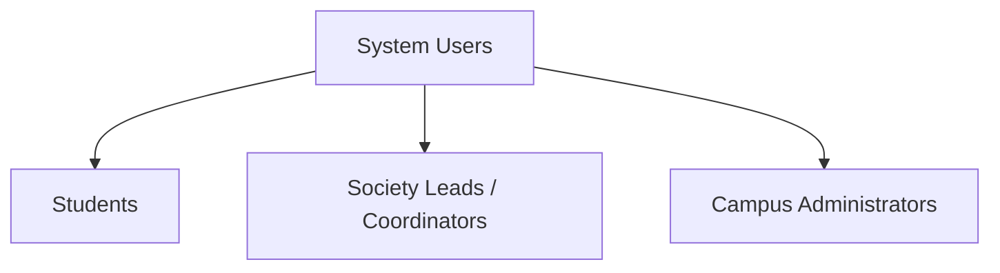
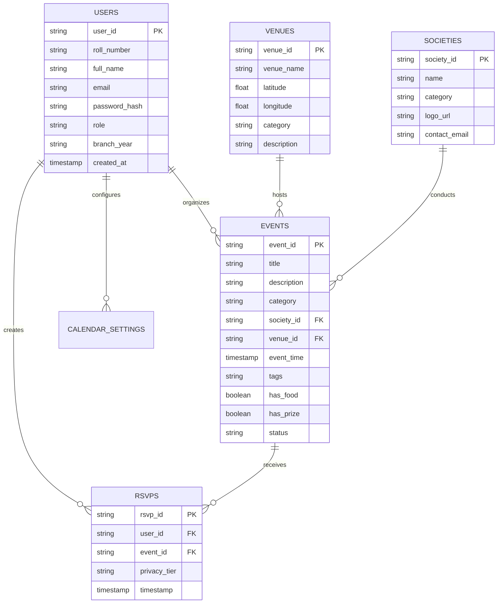
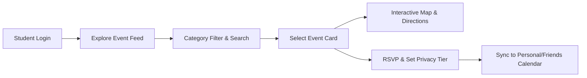
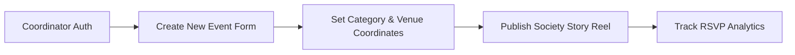
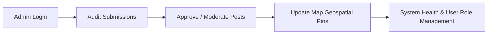

# SOFTWARE REQUIREMENTS SPECIFICATION
### for
# CAMPUSPULSE

**Version 1.0**

---

**Course**: UCS503P Software Engineering  
**Department**: Computer Science and Engineering  
**Institution**: Thapar Institute of Engineering & Technology (TIET), Patiala  
**Date**: October 9, 2026  

---

## Contents

- [1. Introduction](#1-introduction)
  - [1.1 Purpose](#11-purpose)
  - [1.2 Intended Audience and Reading Suggestions](#12-intended-audience-and-reading-suggestions)
  - [1.3 Project Scope](#13-project-scope)
  - [1.4 System Workflow](#14-system-workflow)
- [2. Overall Description](#2-overall-description)
  - [2.1 Product Perspective](#21-product-perspective)
  - [2.2 User Classes and Characteristics](#22-user-classes-and-characteristics)
  - [2.3 Product Functions & Data Schema](#23-product-functions--data-schema)
  - [2.4 Operating Environment](#24-operating-environment)
  - [2.5 System Design & User Activity Flows](#25-system-design--user-activity-flows)
- [3. System Features](#3-system-features)
  - [3.1 Description and Priority](#31-description-and-priority)
  - [3.2 Functional Requirements & Technology Stack](#32-functional-requirements--technology-stack)
- [4. Other Nonfunctional Requirements](#4-other-nonfunctional-requirements)
  - [4.1 Performance Requirements](#41-performance-requirements)
  - [4.2 Security Requirements](#42-security-requirements)
  - [4.3 Software Quality Attributes](#43-software-quality-attributes)
  - [4.4 Business Rules](#44-business-rules)
- [5. Other Requirements](#5-other-requirements)
  - [5.1 Maintenance & Modular Refactoring](#51-maintenance--modular-refactoring)
  - [5.2 Scalability & Future Evolution](#52-scalability--future-evolution)

---

## 1. Introduction

### 1.1 Purpose
In large academic institutions such as Thapar Institute of Engineering & Technology, student activities, club events, hackathons, and administrative announcements are scattered across fragmented channels (WhatsApp groups, Instagram stories, physical posters, and disparate web portals). This causes high information loss, scheduling clashes, and navigation friction for freshmen and visitors. 

**CampusPulse** is an integrated social campus web application designed to digitize, unify, and streamline campus event discovery, spatial navigation, and schedule management. It provides a single verified hub for students, society coordinators, and administrators.

### 1.2 Intended Audience and Reading Suggestions
This Software Requirements Specification (SRS) is prepared for developers, project evaluators, software architects, UI/UX designers, and QA engineers. 
- **Developers & Architects**: Review Section 2.3 (Data Schemas), Section 3.2 (Tech Stack), and Section 4 (NFRs).
- **Project Managers & Evaluators**: Focus on Section 1.3 (Scope), Section 3.1 (Priorities), and Section 4.4 (Business Rules).
- **Testers**: Refer to Section 3 (System Features) and Section 4 (Quality Attributes & Security).

### 1.3 Project Scope
**CampusPulse** provides a dedicated role-based platform for **Students**, **Society Leads / Coordinators**, and **Campus Administrators**:
- **Students**: Register and authenticate using institutional credentials, explore live event feeds with dynamic category filters (Tech, Cultural, Sports, Hackathons, Free Food, Prizes), locate venues using the interactive Leaflet campus map, access venue bottom sheets, and manage personal/friend schedules via a 3-tier privacy calendar (Public, Friends Only, Private).
- **Society Leads & Coordinators**: Create, edit, and publish society events, broadcast urgent announcements/stories, tag geo-coordinates for campus locations, and monitor student RSVPs.
- **Campus Administrators**: Moderate event submissions, manage campus map coordinates and buildings metadata, verify society privileges, and oversee system health logs.

### 1.4 System Workflow

*Figure 1.1: Entire System Workflow*

- **Student Cycle**: Student registers $\rightarrow$ filters & discovers events $\rightarrow$ views map directions $\rightarrow$ saves/RSVPs with 3-tier privacy settings $\rightarrow$ synchronizes personal & friends calendar.
- **Society Coordinator Cycle**: Society Lead logs in $\rightarrow$ creates event with date/category/prizes $\rightarrow$ binds venue coordinates $\rightarrow$ publishes announcement reel $\rightarrow$ tracks attendance.
- **Administrator Cycle**: Administrator reviews submitted event content $\rightarrow$ moderates spam $\rightarrow$ updates campus map building layers $\rightarrow$ maintains system reliability.

---

## 2. Overall Description

### 2.1 Product Perspective
CampusPulse replaces fragmented notice boards and third-party messaging groups with a centralized, responsive Single Page Application (SPA). The application utilizes a decoupled client-server architecture communicating over asynchronous RESTful JSON APIs.

### 2.2 User Classes and Characteristics
CampusPulse caters to three primary classes of users with distinct permission levels:

*Figure 2.1: User Hierarchy*

1. **Students**: General undergraduate and postgraduate students exploring campus activities, syncing social calendars, and locating campus landmarks.
2. **Society Leads / Coordinators**: Verified executive members of registered campus societies (e.g., CCS, OWASP, Rotaract, MLSC) authorized to broadcast official events and news.
3. **Campus Administrators**: Faculty coordinators and system administrators responsible for content moderation, map geospatial accuracy, and user access roles.

---

### 2.3 Product Functions & Data Schema

*Figure 2.2: Entity-Relationship & Data Flow Model*

- **Users Entity**: Stores authentication credentials, full name, Thapar roll number, email, role (`student`, `society_lead`, `admin`), branch/year, and timestamp.
- **Events Entity**: Stores event metadata, host society, scheduled date/time, category (`Tech`, `Cultural`, `Sports`, `Hackathon`, `Food`), venue reference, and incentive tags (`Free Food`, `Cash Prize`).
- **Venues Entity**: Maintains geo-spatial coordinates (latitude, longitude), building name (e.g., LP School, COS, C-Hall), category, and navigation descriptions.
- **RSVPs Entity**: Tracks user attendance, bookmarked items, and privacy visibility tier (`public`, `friends_only`, `private`).
- **Societies Entity**: Holds verified campus organization records, logos, and coordinator links.

---

### 2.4 Operating Environment
- **Client Platforms**: Modern cross-platform web browsers (Google Chrome 110+, Mozilla Firefox 110+, Apple Safari 16+, Microsoft Edge) across Windows, macOS, Linux, Android, and iOS.
- **Server Environment**: Python 3.11+ runtime with Uvicorn ASGI server, deployable on Linux (Ubuntu 22.04 LTS / Debian), containerized Docker engines, or Vercel/Render hosting.
- **Database Engine**: SQLite 3 (development/testing) and PostgreSQL 15+ (production).

---

### 2.5 System Design & User Activity Flows

#### Student Activity Flow

*Figure 2.3: Student Activity Workflow*

#### Society Coordinator Activity Flow

*Figure 2.4: Society Coordinator Activity Workflow*

#### Administrator Activity Flow

*Figure 2.5: Administrator Activity Workflow*

---

## 3. System Features

### 3.1 Description and Priority

| Feature ID | Feature Name | Description | Priority |
|---|---|---|---|
| **SF-01** | **Interactive Event Feed** | Real-time masonry/list feed displaying upcoming events with search, tag filtering, and RSVP buttons. | **High (P1)** |
| **SF-02** | **Campus Geo-Spatial Map** | Interactive Leaflet map centered on Thapar University with custom pins and a slideable Bottom Sheet drawer. | **High (P1)** |
| **SF-03** | **3-Tier Privacy Calendar** | Personal schedule manager allowing users to mark event attendance as *Public*, *Friends Only*, or *Private*. | **High (P1)** |
| **SF-04** | **Society Reel & Announcements** | Horizontal high-priority story reel for official club broadcasts, registrations, and flash updates. | **Medium (P2)** |
| **SF-05** | **Role-Based Auth & Profiles** | Secure JWT authentication with user profile dashboards and saved event tracking. | **High (P1)** |
| **SF-06** | **Admin Moderation & Map CMS** | Administrative dashboard to update campus coordinates, approve society accounts, and moderate posts. | **Medium (P2)** |

---

### 3.2 Functional Requirements & Technology Stack

#### Technology Stack:
- **Frontend**: React 19, Vite, Tailwind CSS, Framer Motion, Lucide React, Leaflet.js.
- **Backend**: Python 3.11, FastAPI, SQLAlchemy 2.0 (Async), Pydantic v2, Uvicorn.
- **Database**: SQLite / PostgreSQL.
- **Documentation & UI System**: MkDocs Material, Dark Y2K Neon styling (`#07070b` dark background, `#00f0ff` neon cyan, `#a855f7` purple accents).

#### Core Functional Specifications:
- **FR-01 (Authentication)**: The system shall provide secure user registration and login issuing signed JSON Web Tokens (JWT) with bcrypt hashing for passwords.
- **FR-02 (Dynamic Filter Engine)**: The feed shall filter events in $< 50\text{ms}$ upon selecting category tags (`All`, `Tech`, `Cultural`, `Sports`, `Hackathons`, `Free Food`, `Cash Prize`).
- **FR-03 (Map Navigation Drawer)**: Selecting a map marker shall smoothly open an Apple Maps-style bottom sheet containing building info, walking instructions, and live events hosted there.
- **FR-04 (Privacy Enforcement)**: The backend shall verify mutual friendship before exposing `friends_only` calendar items and strictly hide `private` entries from third parties.
- **FR-05 (Offline Fallback)**: The frontend client shall provide graceful offline fallback mock data in case of temporary backend connectivity disruptions.

---

## 4. Other Nonfunctional Requirements

### 4.1 Performance Requirements
- **Page Load Speed**: First Contentful Paint (FCP) shall occur within $\le 1.5$ seconds on standard 4G mobile connections.
- **API Response Latency**: Core read endpoints (`/api/events`, `/api/venues`) shall respond in $< 100\text{ms}$ under normal operating loads.
- **Bundle Size**: Client JavaScript bundle shall remain $< 250\text{KB}$ (gzipped) via Vite dynamic chunk splitting.

### 4.2 Security Requirements
- **Access Control**: Role-based access control (RBAC) ensuring students cannot post unverified broadcasts or alter campus coordinates.
- **Data Protection**: All API traffic shall be transmitted over HTTPS/TLS 1.3. Sensitive credentials must never be stored in plain text.
- **Input Validation**: All client payloads must undergo strict Pydantic model validation on the backend to prevent SQL injection and XSS.

### 4.3 Software Quality Attributes
- **Usability**: Intuitive mobile-first interface adhering to Dark Y2K Neon aesthetics with WCAG 2.1 AA compliant contrast ratios.
- **Reliability & Availability**: 99.5% uptime during active semester periods, backed by health-check endpoints (`/health`).
- **Maintainability**: Clean modular separation of concerns across React hooks, UI components, API route handlers, and SQLAlchemy models.

### 4.4 Business Rules
- **Rule 1 (Verification)**: Only verified society coordinator accounts can publish events categorized under official society channels.
- **Rule 2 (Privacy Default)**: New RSVPs shall default to `Friends Only` unless explicitly altered by the user.
- **Rule 3 (Event Timeliness)**: Expired events shall automatically transition to the archived feed state after 24 hours post-event.

---

## 5. Other Requirements

### 5.1 Maintenance & Modular Refactoring
CampusPulse is designed as an evolving software system. The modular architecture facilitates independent updates to frontend components (e.g., upgrading map rendering layers) and backend micro-services (e.g., notification workers) without disrupting core database models.

### 5.2 Scalability & Future Evolution
- **Push Notifications**: Integration of Web Push API and service workers for event reminder notifications.
- **Campus Route Pathfinding**: Expansion of the Leaflet engine to include Dijkstra/A* turn-by-turn indoor and outdoor walking navigation across all Thapar academic blocks.
- **Cross-Campus Multi-Tenancy**: Extensible schema design allowing easy adaptation to other university campuses.

---
